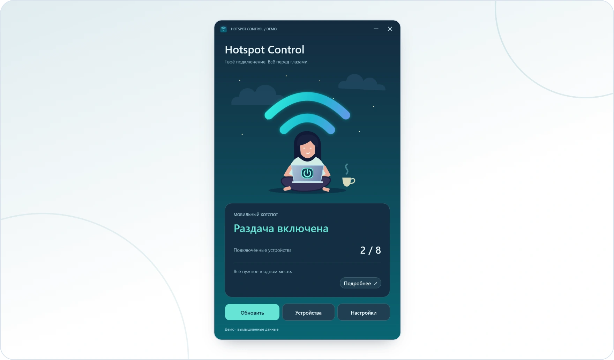

<!-- ppk-readme:head:start -->
<a href="https://popovantondev.github.io/HotspotControl/index-ru.html"><picture><source media="(prefers-color-scheme: dark)" srcset="https://raw.githubusercontent.com/popovantondev/HotspotControl/main/docs/readme/header-ru-dark.9201120c.svg"></picture></a>
<!-- ppk-readme:head:end -->

# Hotspot Control

**Русский** · [Deutsch](README.md) · [English](README.en.md)

<!-- ppk-readme:body:start -->

<a href="https://github.com/popovantondev/HotspotControl/releases/tag/v0.3.0"><picture><source media="(prefers-color-scheme: dark)" srcset="https://raw.githubusercontent.com/popovantondev/HotspotControl/main/docs/readme/btn-download-ru-dark.4aefdc52.svg"></picture></a>
<a href="https://popovantondev.github.io/HotspotControl/index-ru.html"><picture><source media="(prefers-color-scheme: dark)" srcset="https://raw.githubusercontent.com/popovantondev/HotspotControl/main/docs/readme/btn-website-ru-dark.39f97162.svg"></picture></a>
<a href="https://popovantondev.github.io/HotspotControl/Guide-ru.html"><picture><source media="(prefers-color-scheme: dark)" srcset="https://raw.githubusercontent.com/popovantondev/HotspotControl/main/docs/readme/btn-guide-ru-dark.0c50c460.svg"></picture></a>
<a href="https://popovantondev.github.io/HotspotControl/index-ru.html"><picture><source media="(prefers-color-scheme: dark)" srcset="https://raw.githubusercontent.com/popovantondev/HotspotControl/main/docs/readme/btn-demo-ru-dark.2a0b5a28.svg"></picture></a>
<a href="https://github.com/popovantondev/HotspotControl/issues/new/choose"><picture><source media="(prefers-color-scheme: dark)" srcset="https://raw.githubusercontent.com/popovantondev/HotspotControl/main/docs/readme/btn-bug-ru-dark.175df3f6.svg"></picture></a>

<a href="https://raw.githubusercontent.com/popovantondev/HotspotControl/main/docs/images/demo-main-ru.png"><picture><source media="(prefers-color-scheme: dark)" srcset="https://raw.githubusercontent.com/popovantondev/HotspotControl/main/docs/readme/preview-ru-dark.4d2864ab.webp"></picture></a> 
<a href="https://raw.githubusercontent.com/popovantondev/HotspotControl/main/docs/images/demo-main-ru.png">Снимок целиком</a>

<picture><source media="(prefers-color-scheme: dark)" srcset="https://raw.githubusercontent.com/popovantondev/HotspotControl/main/docs/readme/divider-dark.4be5c7a2.svg"></picture>
<!-- ppk-readme:body:end -->

<!-- public-release:start -->
Управляет мобильной точкой доступа Windows, показывает устройства и настройки сети.

**Windows 11 24H2+ · x64 · Выпуск 0.3.0**

**[Скачать](https://github.com/popovantondev/HotspotControl/releases/tag/v0.3.0)** · **[Инструкция](https://popovantondev.github.io/HotspotControl/Guide-ru.html)** · **[Сообщить об ошибке](https://github.com/popovantondev/HotspotControl/issues/new/choose)**

**Требования и ограничения:** Совместимый Wi-Fi-адаптер; политики Windows или организации могут ограничивать операции. .NET входит в пакет.

**Первые шаги:** Проверьте SHA-256, распакуйте ZIP полностью и откройте HotspotControl.App.exe. Отдельная установка .NET не нужна.

**Файлы приложения:**

- [`HotspotControl-0.3.0-win-x64.zip`](https://github.com/popovantondev/HotspotControl/releases/download/v0.3.0/HotspotControl-0.3.0-win-x64.zip)

**Контрольные суммы:** [`HotspotControl-0.3.0-win-x64.zip.sha256`](https://github.com/popovantondev/HotspotControl/releases/download/v0.3.0/HotspotControl-0.3.0-win-x64.zip.sha256)
<!-- public-release:end -->

Hotspot Control — компактное приложение для встроенной мобильной точки доступа Windows 11. Оно показывает состояние и подключённые устройства, управляет раздачей и предлагает настройки сети и автозапуска. Интерфейс, ошибки и трей доступны на немецком, русском и английском. Язык выбирается при первом запуске; последующая смена в настройках применяется после перезапуска.

## Скриншоты

Эти рендеры WPF-превью используют вымышленные данные. Приложение показывает имена устройств так, как их передаёт Windows; примеры имён, адреса и отметка `DEMO` — это не поясняющие тексты интерфейса. Названия языков в окне выбора обозначают доступные варианты.

Показать кадры

- [Главное окно](https://raw.githubusercontent.com/popovantondev/HotspotControl/main/docs/images/screenshots/ru/main.png)
- [Подключённые устройства](https://raw.githubusercontent.com/popovantondev/HotspotControl/main/docs/images/screenshots/ru/devices.png)
- [Простые настройки](https://raw.githubusercontent.com/popovantondev/HotspotControl/main/docs/images/screenshots/ru/settings-simple.png)
- [Расширенные настройки](https://raw.githubusercontent.com/popovantondev/HotspotControl/main/docs/images/screenshots/ru/settings-advanced.png)
- [Выбор языка](https://raw.githubusercontent.com/popovantondev/HotspotControl/main/docs/images/screenshots/ru/language-selection.png)
- [Сообщение о тайм-ауте](https://raw.githubusercontent.com/popovantondev/HotspotControl/main/docs/images/screenshots/ru/timeout-message.png)

## Загрузка и запуск

Скачайте `HotspotControl-0.3.0-win-x64.zip` из [Releases](https://github.com/popovantondev/HotspotControl/releases/tag/v0.3.0), сравните SHA-256 с приложенным файлом `.sha256` и полностью распакуйте архив. Запустите `HotspotControl.App.exe` из распакованной папки. Установка, права администратора и отдельная установка .NET не нужны. Целевая система: Windows 11 24H2 и новее, x64, с подходящим Wi-Fi-адаптером. Политики Windows или организации могут ограничивать функции. Практические испытания пока проводились только на компьютере автора.

Кнопка питания на нарисованном ноутбуке включает и выключает раздачу; выключение отключает клиентов. **Устройства** показывает данные, полученные от Windows. **Настройки** позволяют изменить имя сети, пароль, поддерживаемый диапазон, язык и автозапуск для текущего пользователя. Пустое поле нового пароля сохраняет прежний пароль. Для изменения параметров сети точка доступа должна быть выключена. Сворачивание скрывает окно в трее; щелчок по значку возвращает его. Закрытие завершает приложение, не меняя состояние точки доступа. Зелёные волны означают включённую раздачу; серые — выключенную или неизвестное состояние.

Автовключение при запуске необязательно. `HotspotControl.App.exe --no-auto-start` открывает приложение без него. После тайм-аута операция Windows всё ещё может завершиться: перед следующим действием проверьте состояние. Ограничение скорости отдельных устройств не поддерживается.

## Конфиденциальность

Нет облака, телеметрии и локальных журналов с именами сетей или адресами устройств. Язык и настройка автовключения хранятся в `%LOCALAPPDATA%\HotspotControl\preferences.json`; ярлык запуска с Windows находится в папке автозагрузки пользователя. Приложение не сохраняет пароли. Удаляйте личные данные со скриншотов и из сообщений об ошибках. Изображение выше содержит вымышленные данные.

## Сборка и проверка

Для сборки нужен .NET 10 SDK на Windows: `./Run-Checks.ps1` и `./Publish.ps1`. Другой SDK можно передать через `-DotnetPath`. Скрипт создаёт ZIP и SHA-256 локально в `artifacts/` и ничего не загружает.

[Архитектура](docs/ARCHITECTURE.ru.md) · [Релиз 0.3.0](docs/RELEASE_0.3.0.ru.md) · [Превью](docs/PREVIEW.ru.md) · [Изменения](CHANGELOG.ru.md)

## Права

Исходный код не распространяется под открытой лицензией. Разрешено личное использование неизменённой бинарной версии. [Права](RIGHTS.ru.md) · [Сторонние компоненты](THIRD_PARTY_NOTICES.ru.md).
